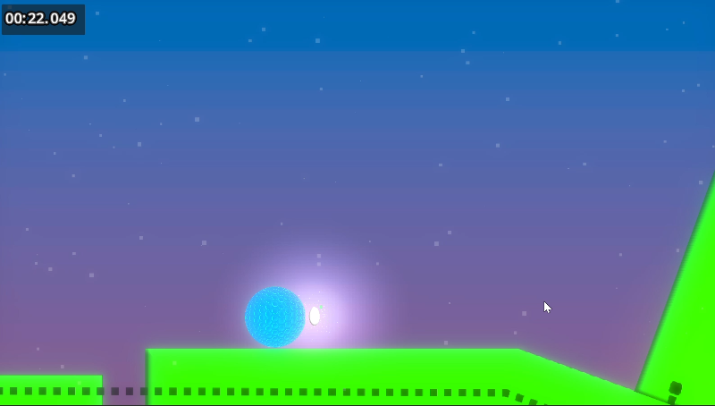

# **Golf?**
## Golf? is a puzzle platformer game about kicking a ball around to a flag to complete levels.

## [Play Golf? on itch.io](https://hedgehog8110.itch.io/golf)

*Controls:*
  - When in the start screen, click space to start the game.
  - A or left arrow to move left, D or right arrow to move right, and W or up arrow to jump.
  - While in the air, tap up arrow or W to double jump in the air.

*Gameplay:*
  - Use the control keys to maneuver the ball to the flag at the end of the level.
  - Buttons: Touch the button with the ball or the player to remove parts of the level, dotted wires indicate a connection to the dissapearing wall.
  - Teleporters: The teleporters can only teleport either the ball or the player, depending on the switch position. For example: when the dots on the teleporters are set to white, it will only teleport the player, but when the dots are set to blue, it will only teleport the ball. When the player or ball has entered, it will have a short cooldown for teleporting back.
  - Switches: Touch switch with the player or the ball to toggle its mode. When the dot in the middle is white, it will set the teleporters to only teleport the player, but when the dot is blue, it sets the teleporters to only teleport the ball.

*Features:*
  - Puzzle aspects
  - Tricky platforming
  - Teleporters
  - Buttons and switches
  - Rankings based from the time you score.

*Technical aspect:*
  * The teleporters:
    * How they work: Both teleporters set their position as a global variable when the level starts, they set their animation depending on what the switch is set to. When the ball or player enters the teleporter, (it uses an on_body_entered() function) it sets a global variable to "Player" or "Ball" depending on which has entered (if the switch is set to the number that determines the object that enters). In both the player and ball code it is detecting if the global variable is set to itself. If it is, it will check which teleporter is transmitting the variable and set its position to the opposite teleporter.

*Download instructions for mac*
  1. Click on the download button on the itch page
  2. It should download
  3. Locate the file in finder and double click it, that should create a folder for it
  4. Double click the folder
  5. That should launch the game, but if not, follow next insructions
  6. Open settings and go to the privacy and security tab
  7. Scroll to the bottom of the privacy and security tab there should be text saying that the file was blocked by your mac
  8. Press open anyway
  9. A new window will open, press open anyeway
  10. That should work then

*Credits and thanks*
  - Pixabay for music and sounds
  - Friends, family and school teachers for helping out with some bugs
  - YouTube Godot tutorials for helping me learn
 
 
